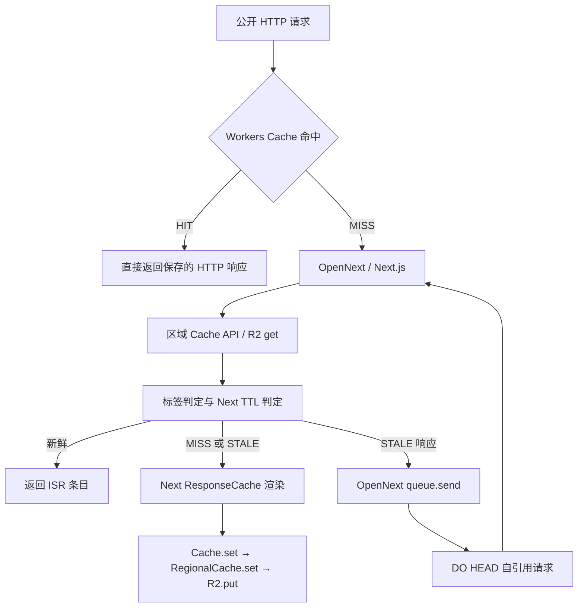

# Next.js / OpenNext / Cloudflare 缓存独立调查

调查日期：2026-10-09。生产操作仅限只读 API、历史公开页面缓存下载和五次公开 HTTP GET；未修改数据库、部署、push 或恢复 site-cache。没有手动读取 `.env` / `.dev.vars`。本地复现的 R2 和 D1 都是临时空资源。

## 结论与证据边界

**已证明一个会在一天 TTL 内错误重建的具体代码缺陷；尚未证明它解释生产样本的全部 274 / 532 / 568 次写入。**

直接执行 10 月 5 日实际部署包，配合同 build、同路径的真实 R2 分类页对象：

1. 缓存的 revalidate=86400，实际年龄只有数秒，tag 表没有失效行。
2. 冷 isolate 中，该具体路径不在 prerender manifest 的 routes 中，SharedCacheControls 也没有记录。
3. 旧 `withStoredRevalidate` 把读取结果的 lastModified 改成调用标签查询**之前**的 now。
4. 标签查询仅增加 1200ms 延迟，Next 就用 lastModified+1000ms 判成 STALE。
5. Next 原生 ResponseCache 执行后台渲染，对**相同分类页 .cache 键**做 PutObject。同时 OpenNext 发出队列消息。
6. 按官方队列 HEAD 形态手动回放该消息，返回 REVALIDATED，又写相同 .cache 一次。
7. 热 isolate 此后记住 86400 秒，同样的慢查询返回 HIT、不写页面缓存。

这证明旧包装没有可靠修复路由 TTL 的持久化，而且其伪时间戳可以参与队列 dedup/sync 判断。**1200ms 是人为注入的复现条件，不是已经测得的生产 D1 延迟。** 队列 RPC 在复现中仅捕获，随后手动回放 HEAD；没有运行真实 DO 调度器，也没有模拟外层 Workers Cache。不能据此宣布生产每次 STALE 都恰好写两次。

全局 `/_not-found` 则不同：实际 manifest 有该路由，initialRevalidateSeconds=false。真实部署包在本地首次 MISS 写入一次，后续 GET、HEAD、RSC、query、多种不存在路径均 HIT，不再写。旧“404 缺 manifest 所以默认 1 秒”的解释被这个反例否定。

## 当前与历史部署核对

本地开始调查时 HEAD=4eb6839。当前线上实际部署为 `060c0f84-bcea-4991-86e2-f8e38e4fb8ba`，部署 API 时间为 10 月 9 日 00:52:29 北京时间，build=`Ue8nPMDBSxGinq0k8n07n`。

重新下载的模块中，入口是官方 worker，incrementalCache/tagCache 都是 dummy，未包含 `applyEdgeCachePolicy` 或 `applyStoredRevalidate`。线上 R2 仅保留媒体 BUCKET=blog，Workers Cache enabled=true。**交接里“当前本地方案尚未上线”的时间状态已经过时**；本次没有执行部署。

当前线上公开 GET 验证（[原始结果](cache-evidence/live-http-check.json)）：

| 请求 | Cloudflare 结果 | Next 缓存头 | 含义 |
| --- | --- | --- | --- |
| /skills 两次 | HIT / HIT，Age 约 30583 秒 | x-nextjs-cache: MISS | Cloudflare 返回之前保存的响应；MISS 是那份响应的旧头，不表示本次执行 Next |
| /skills?cache_research_probe=20261009 两次 | MISS → HIT，Age=1 | s-maxage=86400 | 同一带 query 公开响应可进 Workers Cache |
| 不存在 API | 404 / BYPASS | private, no-store | 外层缓存保护正确；当前 dummy 不可能写 site-cache |

[Cloudflare Workers Cache 文档](https://developers.cloudflare.com/workers/cache/)说明 HIT 在 Worker 执行之前返回响应。以上验证不是 ISR 一天 TTL 的生产验证：当前 ISR 持久存储仍关闭，边缘 MISS 会渲染、读业务数据。

历史包也核对了两个关键点：

- 9/27 `531ac5c2-25a7-46fd-b84d-3d3074193daf`：实际包含 WP fetch 300 秒、官方 regional R2 + D1 tags + DO queue；没有时间戳包装。页面声明 86400 与 fetch 300 的差别是真实框架行为，但不用于解释后来的一天 TTL 样本。
- 10/5 `5c49234d-6ae7-4dac-a86a-8930f1ed10b9`：实际包含时间戳包装、86400 秒数据缓存与自定义边缘策略，SDK 为 Next 16.3.4 / Cloudflare 1.20.4 / OpenNext AWS 4.1.2。

[当前部署模块摘要与 SHA256](cache-evidence/current-deployment.json)。完整部署模块留在 `/private/tmp/blog-cache-investigation`，不提交含完整 prerender preview 信息的生产包。

## R2 写入类型与原始读写聚合

新查询将相同历史统计窗口中的 PutObject 按扩展名分开（[原始 GraphQL 返回](cache-evidence/writes-by-cache-type.json)）：

| build | 页面 .cache | 数据 .fetch | .composable | 合计 |
| --- | ---: | ---: | ---: | ---: |
| COpPMwdTJzoj2SKZju0HJ，9/27 版 | 233313 | 312608 | 0 | 545921 |
| J5PPb7srTSwdHseCUtnyX，9/29 版 | 128128 | 50401 | 0 | 178529 |
| IKi4FcCP-pi2RxE66B9bf，10/5 版 | 33303 | 22859 | 0 | 56162 |

窗口为 UTC 9/16 16:00 至 10/8 09:37，各日期桶为 UTC；是 adaptive analytics 聚合，可能含估算。扩展名区分保存内容，不能单独区分部署上传与运行时写入。

对 UTC 10/7 09:00 至 10/8 09:00 的三个具体对象重新查询 actionType/actionStatus/responseStatusCode（[原始返回](cache-evidence/r2-operations.json)）：

| 页面键 | PutObject | GetObject | 返回的状态组 |
| --- | ---: | ---: | --- |
| /zh/category/js，12bf92… | 274 | 258 | 均 success/200 |
| /zh/posts/userfiles，3a0d7c… | 532 | 663 | 均 success/200 |
| /_not-found，788bf1… | 568 | 2998 | 均 success/200 |

返回聚合中没有读错误组，**不等于每一个 Worker 读取都成功**，也不能关联某次 Get 与某次 Put。`eyeballRegion` 不能当作 Worker 执行机房、R2 副本或 Cache API colo 的证据。当前只读 D1 查询确实未找到 IKi… 前缀的失效行（rows_written=0）；未证明历史上从未发生失效或清理。

## 已追踪的调用链



已从历史源码与本地调用栈区分：

- **区域回填**：regional get 的 MISS 从 R2.get 取条目，再 Cache API.put；lazy HIT 后台也是 R2.get → Cache API.put。两者都不调用 R2.set/put。这条路径解释读量，不能直接解释 Class A PutObject。
- **页面正常写入/重建**：APP_PAGE/APP_ROUTE → OpenNext Cache.set → incrementalCache.set(type=cache) → RegionalCache.set → R2.put。local stack 直接落在分类页原 hash。
- **fetch 数据缓存**：FETCH / unstable_cache → Cache.set(type=fetch) → R2.put，单次渲染可以写多条 .fetch。
- **失败回退写入**：Next ResponseCache.handleRevalidate 的 catch 在已有 cacheControl 时，可能用 3–30 秒重写旧条目以限制错误重试。此 Put 不是一次成功生成新页面；这条生产发生频次尚未验证。
- **部署上传**：OpenNext populate-cache 的独立上传 Worker 接收 POST /populate，再 R2.put；不是 ISR 请求。build ID 只标识缓存命名空间，不能拿 Put 总数当渲染计数。
- **404**：OpenNext fixCacheControlForError 只改 HTTP 输出缓存头。Next 的首次 notFound 渲染仍可能先经 APP_PAGE 写 R2，之后才向客户端输出 no-store。复现包含完整 manifest，未使用空 manifest。

## 可运行复现与观测值

脚本：[scripts/research/reproduce-isr-writes.ts](../scripts/research/reproduce-isr-writes.ts)。直接使用已下载的历史 Worker 模块/WASM，以及真实公开分类页对象。

```sh
node scripts/research/reproduce-isr-writes.ts \
  /private/tmp/blog-cache-investigation/5c49234d-6ae7-4dac-a86a-8930f1ed10b9/worker.js \
  /private/tmp/blog-cache-investigation/category.cache \
  /private/tmp/blog-cache-investigation/reproduction.json
```

没有生产绑定、账号或 OAuth 读写代码；不会发送外部 fetch。脚本把 HTTP 渲染的 waitUntil 工作等完再统计，避免只看到响应头而漏掉后台写入。真实 DO 调度由捕获 RPC + 手动 HEAD 回放替代，此局限也保存在 JSON。

[本次已通过断言的完整结果](cache-evidence/historical-runtime-reproduction.json)：

| 场景 | 响应 | 页面 Put | 其它证据 |
| --- | --- | ---: | --- |
| 新鲜分类页，正常 tag 读取 | HIT | 0 | 同原页面键 |
| 新鲜分类页带 query | HIT | 0 | 旧自定义 Worker 强制 Cloudflare no-store，证明旧策略排除了 query |
| 冷 isolate，tag 读取延迟 1200ms | STALE | 1 | 页面原条目 age 约数秒；无 cacheControl；发 queue 消息；另有 4 次 .fetch Put |
| 按队列形态 HEAD 回放 | REVALIDATED | 1 | 仍是相同页面 hash；fetch 已命中 |
| 热 isolate，再延迟 1200ms | HIT | 0 | SharedCacheControls 已是 revalidate=86400 |
| 全局 404 首次访问 | MISS / 404 | 1 | 键为 /_not-found；manifest TTL=false |
| 同一/另一个全局 404，含 RSC | HIT / 404 | 0 | 仍是 manifest TTL=false，没有 1 秒回退 |

这已经证明缺陷和写入来源，但无法恢复历史每次请求的延迟、isolate 状态、渲染结局以及 DO 执行结果。

## 最小原生方案与恢复门槛

**当前可接受的最小方案就是保留原生入口 + dummy 止损。** 本次不增加产品 Worker、缓存 adapter 或伪时间戳修补。已有方案的公开 query Workers Cache HIT 已在线验证，但不能说 ISR 根因因此解决。

未来恢复时，单纯把 incrementalCache 改回官方 R2 不够：

1. **具体路径 TTL 必须跨 isolate 正确**。冷进程没有该路径的 SharedCacheControls 时，当前 Next 的读取没有使用 R2 value.revalidate。可以评估官方 cache interception，或推进 OpenNext/Next 修复元数据读取；避免再造 lastModified。已尝试在历史包副本中切换 interception + prefetchInlining=false：热请求可从 interceptor 按 stored TTL 返回，但首请求仍走旧编译入口，所以这个修改旧包的实验不是完整原生构建验收。
2. **segment prefetch 必须正确**。当前安装的 AWS 4.1.2 仍含 `!NextConfig.experimental?.prefetchInlining` 条件；缓存有 /_tree，默认 inlining 为对象时会错用整页 RSC。[上游说明与未合入的 Cloudflare PR](https://github.com/opennextjs/opennextjs-cloudflare/pull/1348)支持这个具体分支问题。可以验证 Next 原生 `experimental.prefetchInlining=false` 的取舍，或等正式修复；不能直接打开 interception 后宣布完成。
3. **404 要在写入之前排除**。单靠 Next/Cloudflare HTTP headers 不满足“不写 R2”。原生全局 404 会预渲染，部署上传也要排除这份缓存；动态内容 notFound 的页面写入也要阻止。当前官方 R2 adapter/配置没有已验证的按状态写入过滤机制。需要上游写入/上传支持，或接受非常小的官方 SDK 补丁；当前不提供未经验证的产品 adapter。
4. **官方 DO HEAD 要绕过外层 Workers Cache**。当前队列发送 x-prerender-revalidate/x-isr，没有 cf.cacheControl 覆盖；当前 Next Vary 也不包含该鉴权头。[Cloudflare 支持同账号调用的 cf.cacheControl 覆盖](https://developers.cloudflare.com/workers/cache/configuration/)。这是必须实测的兼容性风险，尚未做真实 Service Binding + Workers Cache 验收；不能当已证明的历史重复写入原因。
5. **并发与失败场景**。冷并发 MISS、慢 tag、源站错误回退、原生后台重建与 DO 重建同时触发，需要测实际 R2 页面 Put 上界。每日 ISR 是流量触发的 freshness 窗口，不是每天定时执行一次、也不是框架保证全球精确一次写入。

为验证原生候选，另建了仅本地的最小 Next 项目：Next 16.3.4 构建成功，试验 connection/noStore 的缺失内容分支；OpenNext 完整打包在隔离依赖的 standalone 路径/Sharp 原生模块解析处失败。没有通过该候选的 Worker 验收，因此**未把它称为可恢复配置或提交产品修复**。失败日志保留在 `/private/tmp/blog-cache-investigation/native-opennext-build.log`。

## 尚缺的生产证据

- 同一页面请求的真实 lastModified、Next cacheControl、判定时刻、tag 查询耗时与返回行、isolate/请求 ID。
- STALE 对应的原生后台任务和 DO message/执行/重试/sync-table 结果；关联到具体 R2 Put。
- 高频 /_not-found 的 MISS、强制重验证、并发、条目形态及请求头。当前正常 GET/HEAD/RSC 矩阵没有复现其 568 次日写入。
- R2 每次 Put 的内容/版本/调用者与上传事件。当前对象只保留最后内容，analytics 不能还原所有历史值。
- Service Binding 在 Workers Cache 前是否实际命中以及绕过后的 REVALIDATED；不能用本地无外层缓存的 HEAD 回放代替。

这些缺口不能通过重跑汇总图或读取更多文档填满。现在生产没有 R2 绑定，不能在不恢复它的条件下观测历史 ISR 的完整真实运行链；本次没有为获取证据突破这个限制。

## 验证

- 离线历史部署脚本：8 个探针，关键行为断言全部通过，保存页面与 fetch 的真实调用栈。
- 当前线上原生入口/dummy/R2 绑定：只读 API 与部署源码确认；公开 query MISS → HIT、API 404 BYPASS。
- 仓库回归：67 个测试文件、548 项测试通过；typecheck 通过；Next.js 生产构建通过。
- 本次修改只含调查脚本、证据、文档；生产运行配置没有修改。

## 后续本地验收：完整原生构建与真实 DO（2026-10-09）

用户授权先本地、再线上测试，最终指定免费账号 `07ee1a1a1cf0da549eaaf6d3c5c80b62`。
只读预检返回 R2 未启用（10042），用户随后决定先完成本地、稍后开通 R2。本次没有创建线上资源或部署 Worker。

测试应用在 `scripts/research/cache-lab`，独立安装锁定依赖，完全隔离父项目的 middleware。
Next 16.3.4 / Cloudflare 1.20.4 / AWS 4.1.2 的完整构建与 Worker dry-run 成功，解决了前一轮最小项目的打包障碍。
入口是官方 `.open-next/worker.js`；采用官方 R2 / DO queue、cache interception=true，Next prefetchInlining=false。
合成数据源由运行器提供离线响应，没有使用生产 WordPress、D1、R2 或 `.env`。

[本地完整结果与事件](cache-evidence/native-local-validation.json)、[上传过滤结果](cache-evidence/native-upload-filter-validation.json)、[账号预检](cache-evidence/test-account-preflight.json)。

| 项目 | 实测结果 | 结论范围 |
| --- | --- | --- |
| 一天 TTL 页面首次访问 | MISS，页面 Put=1 | 条目保存 revalidate=86400 |
| 再访问及 query | HIT，页面 Put=0，渲染时刻不变 | 官方拦截读取存储 TTL 正常 |
| 重启 isolate | HIT，页面 Put=0 | 此候选无需伪造新鲜时间戳 |
| 模拟对象年龄 86300s / 86500s | 前者 HIT；后者 STALE，真实队列重建一次 | 测试夹具调整读出的上传时间，没有真的等 24h，也不是产品补丁 |
| 短 TTL 过期后 8 个并发 GET | 队列收到 8 次、执行 1 次、页面 Put=1 | 已实际运行官方 DO 与 SQL 去重，不是手动 HEAD 回放 |
| 故意让首次重建失败 | HEAD 返回 500，仍 Put 旧页面；原生 alarm 重试后 REVALIDATED，再 Put 新页面 | 两次 Put 只有一次成功生成新内容；由渲染时刻与队列响应同时确认 |
| 页面 5s TTL、底层 fetch 86400s | 首次 .fetch Put=1；页面重建后 .fetch Put=0、数据源仍只请求 1 次 | 页面重建与数据缓存刷新不是一一对应 |
| 分段 RSC /_tree | x-nextjs-postponed=2 | 服务端分段协议通过；未据此宣称浏览器预取整流程已验收 |
| 原生内容 404 / 全局 404 首次 | 两者各页面 Put=1 | 原生响应 no-store 不能阻止增量缓存写入 |
| SDK 最小运行时过滤候选 | 两类 404 仍返回 404，页面 Put=0 | 仅过滤 `.cache`，不改 TTL、lastModified 或 HTTP 响应 |
| 官方上传资产枚举的过滤候选 | 基线有 /_not-found；过滤后排除它 | 运行时过滤之外，还必须阻断部署上传；本地执行真实枚举函数及补丁副本，没有上传 |
| 先取缓存数据再 notFound | 页面 Put=0，但 .fetch Put=1 | **仍不满足“所有 404 请求零 R2 写入”的严格要求** |

在 missing 分支尝试 connection() / unstable_noStore() 的两轮实验均返回 500 / DYNAMIC_SERVER_USAGE；这些方式已经从测试候选移除，没有进入产品代码。

最小 SDK 补丁候选见 [native-sdk-404.patch](cache-evidence/native-sdk-404.patch)：分别过滤官方 R2.set 与上传资产枚举。
它没有应用到主项目或安装的 SDK，只在本地临时副本验证。它能阻断 404 页面对象，但数据缓存可能在最终 404 状态产生前已经写入；不能把这个候选报告成严格要求的完整修复。

当前本地阶段已经获得原生 TTL、真实队列、失败回退、数据缓存和 404 的明确证据。
线上仍要验证真实 Workers Cache HIT 是否跳过 Worker、DO HEAD 是否被缓存截住、多地域行为，以及进一步解决 404 的数据写入边界。
本地 dispatchFetch 即使设置 cache.enabled，也仍记录了每次 worker-fetch、没有 CF-Cache-Status，因此没有用该探针代替线上缓存验收。

本轮主仓库 548 项测试、typecheck 通过；测试应用完成独立类型检查、Next/OpenNext 构建和 Worker dry-run。

## 重新聚焦历史爆量：实际 404 条目的请求矩阵（2026-10-09）

用户指出验收新方案不能代替找出大量写入的原因。本节继续使用实际 10/5 部署包和只读下载的高频 `/_not-found` 原始对象，不使用简化测试应用。

最新保留条目为 app、revalidate=false，HTML 7175 字符、RSC 3169 字符，包含 /_tree、/_full 和页面分段。
用该对象初始化本地 R2 后，执行 70 个请求：不同未知路径、GET/HEAD/POST/PUT/OPTIONS、JSON/表单、无效 Server Action 头、RSC 分段预取、no-cache、purpose=prefetch，以及 1200ms tag 读取。
全局对象 Put=0，未捕获增量适配器读取异常。[请求矩阵](cache-evidence/historical-404-request-matrix.json)。

这进一步排除了“普通未知请求必定重写 404”“404 默认 1 秒”“慢 tag 同样使 false TTL 404 过期”的解释。
它只验证当前保留条目与这些本地请求形态，不能证明历史每一次条目都完整，或 Cloudflare 上的 Cache API / R2 / tag 读取没有异常。

根因调查仍未完成：正常页已复现错误新鲜度、原生重建/队列额外写入与失败回退写入；生产 274 / 532 / 568 次的逐次触发原因没有关联日志。
后续线上复现应优先运行历史原版代码，在独立测试桶记录 MISS 原因、实际 cacheControl、标签结果、重建调用者和 Put 内容，而不是只验收新配置。
生产旧部署未开启 observability，现有 R2 聚合不能恢复这些调用记录；不能将人工注入慢查询或本地新方案通过当作完整生产归因。
